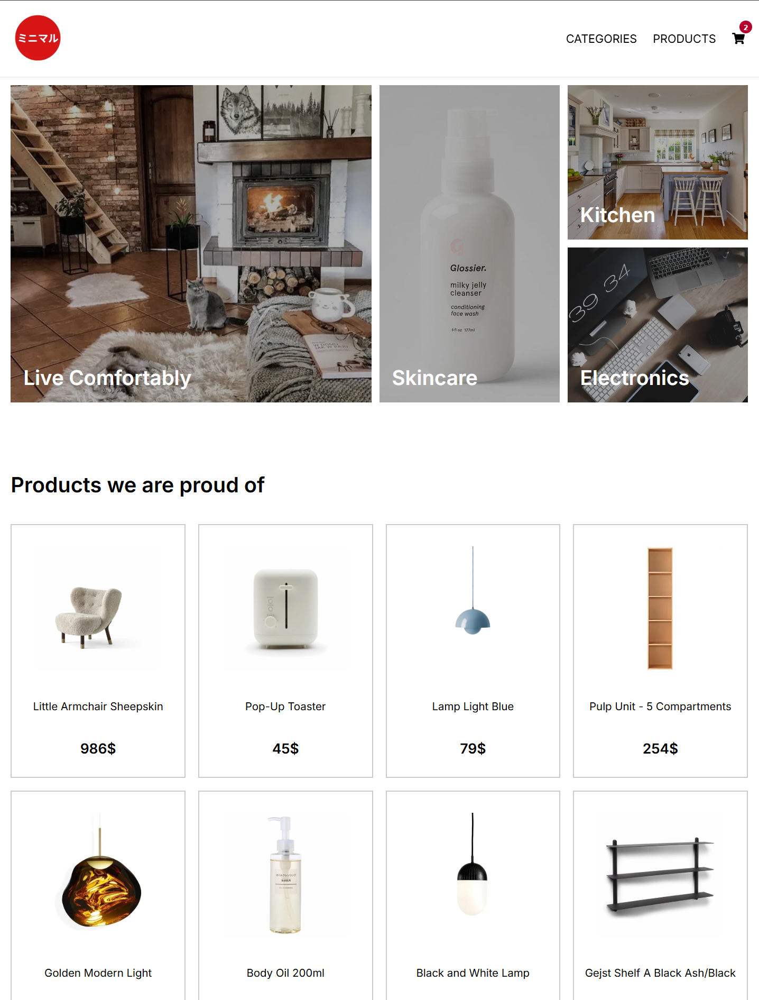
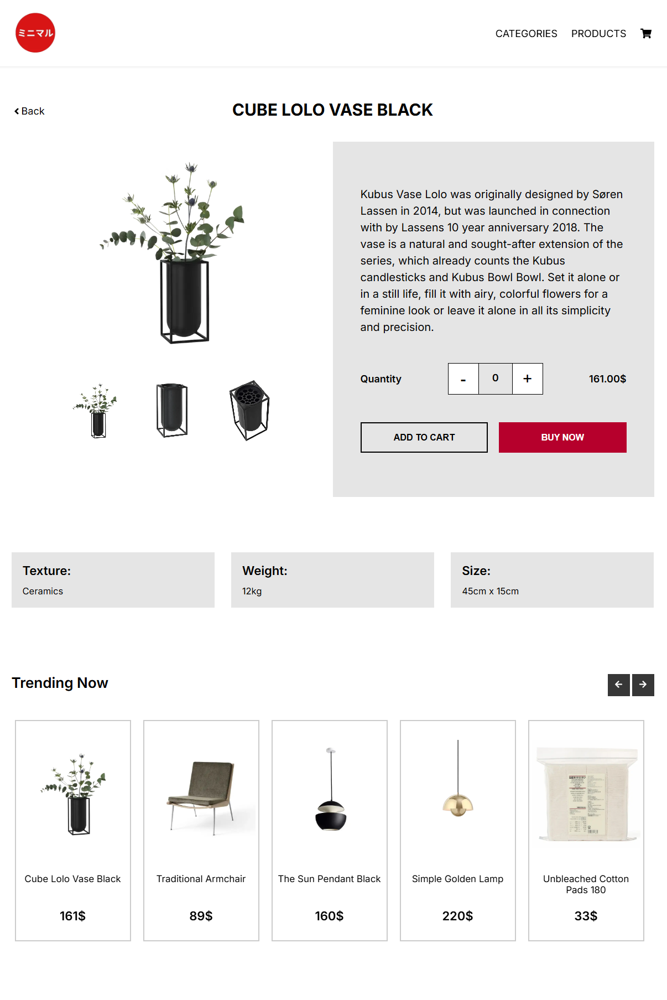
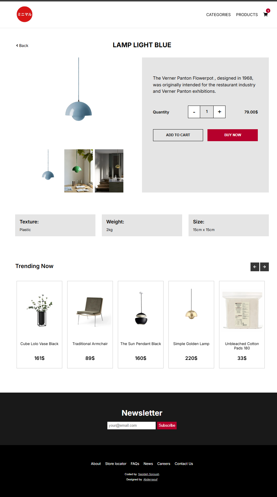
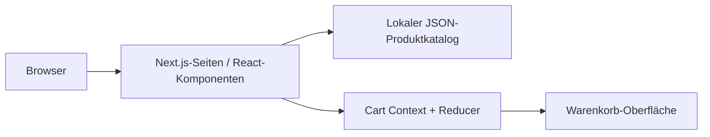

# MiniShop — E-Commerce-Showcase mit Next.js

**Ein responsiver Onlineshop-Prototyp auf Basis von Next.js, React und einem clientseitigen Warenkorb.**

**Sprache:** [English](README.md) · Deutsch · [Frühere Dokumentation](README.legacy.md)

**Technologien:** Next.js 13 · React 18 · Context API / useReducer · CSS / Tailwind · lokaler JSON-Produktkatalog

> **Status:** Portfolio- und Lernprojekt. Die aktuelle Startseite verwendet einen lokalen Produktkatalog (`src/data/products-local.json`). Eine Zahlungsabwicklung, ein Checkout-Backend, eine Bestellabwicklung oder ein produktiv betriebener Dienst sind im Repository nicht nachgewiesen.

## Überblick

- Produktübersicht mit Highlights, Trends, Kategorien und dynamischen Produktdetailseiten.
- Artikel im Warenkorb hinzufügen, entfernen und löschen; Zustandsverwaltung mit React Context und Reducer.
- Responsives Layout mit wiederverwendbaren UI-Komponenten.
- Produktkatalog und Bilder liegen lokal im Repository; zum Erkunden ist keine laufende Datenbank nötig.

## Screenshots

Die folgenden Bilder sind **bereits vorhandene Dateien im Repository**, keine neuen Aufnahmen einer verifizierten Bereitstellung.







Weitere Bilder: [`public/docs/`](public/docs/).

## Architektur



| Ebene | Implementierung |
| --- | --- |
| Seiten und dynamische Routen | `src/pages/` |
| Wiederverwendbare Komponenten | `src/components/` |
| Warenkorb und Reducer | `src/context/CartProvider.js` |
| Produktdaten | `src/data/products-local.json` |
| Screenshots | `public/docs/` |

## Lokal starten

**Voraussetzungen:** Node.js und npm, kompatibel mit Next.js 13.3.1.

```bash
npm install
npm run dev
```

Danach [http://localhost:3000](http://localhost:3000) öffnen. Für einen lokalen Production-Build:

```bash
npm run build
npm run start
```

Die Befehle stammen aus der `package.json` und wurden bei dieser Dokumentationsänderung **nicht ausgeführt**.

## Technische Entscheidungen

- Der Warenkorb nutzt einen eigenständigen Reducer; der Zustand wird in der laufenden React-App gehalten.
- Die aktuelle Startseite importiert Produktdaten aus einer lokalen JSON-Datei. Firebase ist als Abhängigkeit vorhanden; ein betriebsbereites Firebase-Backend wird hier **nicht behauptet**.
- Das Projekt ist ein Shop-Prototyp und kein vollständiges Zahlungs- oder Bestellsystem.
- CI und automatisierte End-to-End-Tests sind in diesem Repository nicht nachgewiesen.

## Demo für Recruiter

1. Produktkatalog und Kategorien öffnen.
2. Eine Produktdetailseite ansehen.
3. Produkte in den Warenkorb legen, Mengen ändern und Summen erklären.
4. Die Zustandsverwaltung mit Context API und Reducer erläutern.

## Abgrenzung und Ausblick

Denkbare Erweiterungen sind persistente Warenkörbe, Produktverwaltung, echte Bestell- und Inventar-APIs, Tests sowie ein barrierearmer Checkout. Diese Punkte werden **nicht** als fertig umgesetzt dargestellt.

*Portfolio-Schwerpunkte: React, Next.js, Komponentenarchitektur, clientseitiges State Management und responsives UI.*