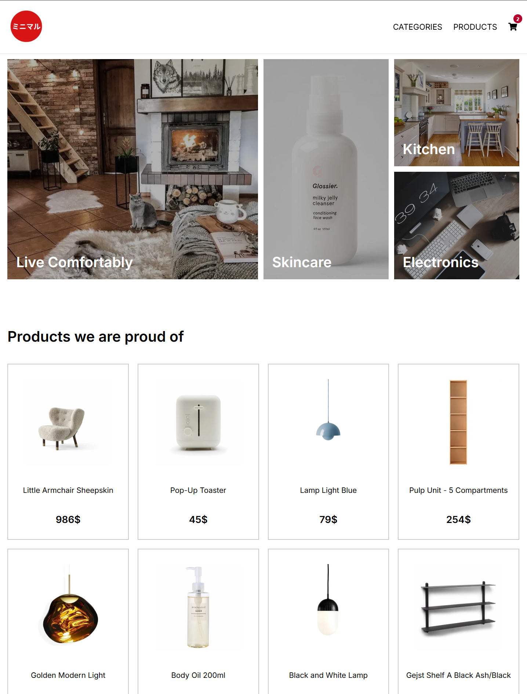
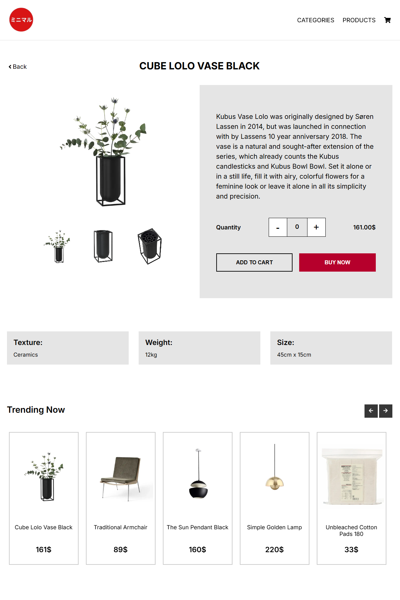
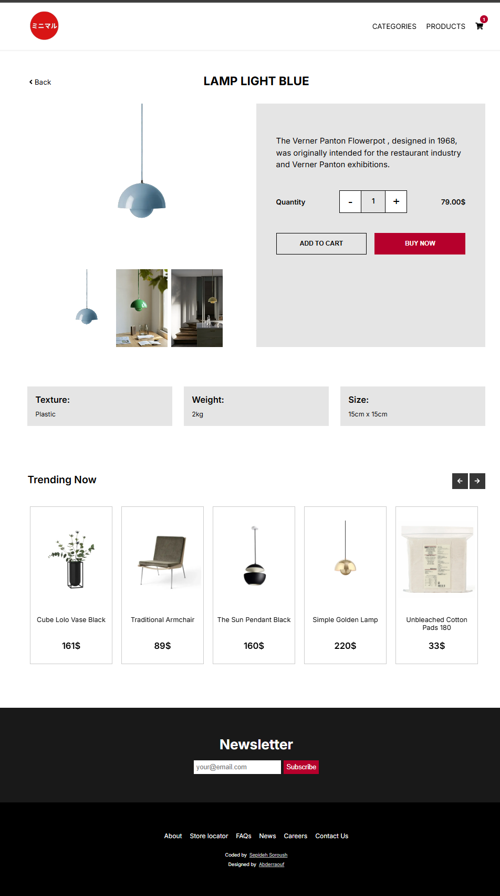
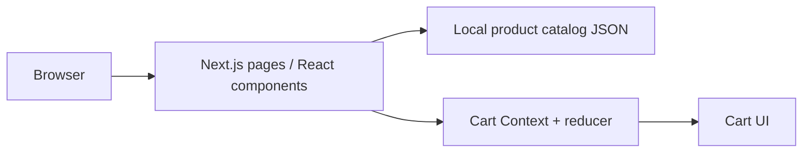

# MiniShop — Next.js E-commerce Showcase

**A responsive storefront built with Next.js, React and a client-side shopping cart.**

**Language:** English · [Deutsch](README.de.md) · [Original notes](README.legacy.md)

**Stack:** Next.js 13 · React 18 · Context API / useReducer · CSS / Tailwind · local JSON product catalog

> **Status:** Portfolio / learning project. The current home page reads a local product catalog (`src/data/products-local.json`). No payment processing, checkout backend, order fulfilment or hosted production service is demonstrated by this repository.

## At a glance

- Product discovery through home-page highlights, trending products, categories and product detail routes.
- Add, remove and delete items from a shopping cart managed by React Context and a reducer.
- Responsive storefront layout and reusable UI components.
- Product catalog and images stored in the repository; the app can be explored without a live database.

## Screenshots

These screenshots are **existing repository assets**, not new captures from a verified deployment.







More images: [`public/docs/`](public/docs/).

## Architecture



| Layer | Where to look |
| --- | --- |
| Pages and dynamic routes | `src/pages/` |
| Reusable storefront components | `src/components/` |
| Cart state and reducer | `src/context/CartProvider.js` |
| Product data | `src/data/products-local.json` |
| Product screenshots | `public/docs/` |

## Run locally

**Requirements:** Node.js and npm compatible with Next.js 13.3.1.

```bash
npm install
npm run dev
```

Open [http://localhost:3000](http://localhost:3000). For a production-style local build:

```bash
npm run build
npm run start
```

The commands are taken from `package.json`. They have **not** been executed during this documentation update.

## Engineering notes

- The cart logic is a standalone reducer; its state is held in the running React application.
- The current home page imports local product JSON. Firebase is still listed among dependencies, but this README does **not** claim an operational Firebase backend.
- This is a storefront prototype, not a production payment or inventory system.
- The repository does not demonstrate automated CI or end-to-end test coverage.

## Demonstration for recruiters

1. Browse products and categories.
2. Open a product detail page.
3. Add products to the cart; adjust quantities and inspect totals.
4. Explain the Context API/reducer state design and data flow.

## Scope and next steps

Potential enhancements include persisted cart state, product administration, real inventory/order APIs, automated tests and an accessible checkout flow. These are **not** represented as completed features.

*Portfolio focus: React, Next.js, component architecture, client-side state management and responsive UI.*